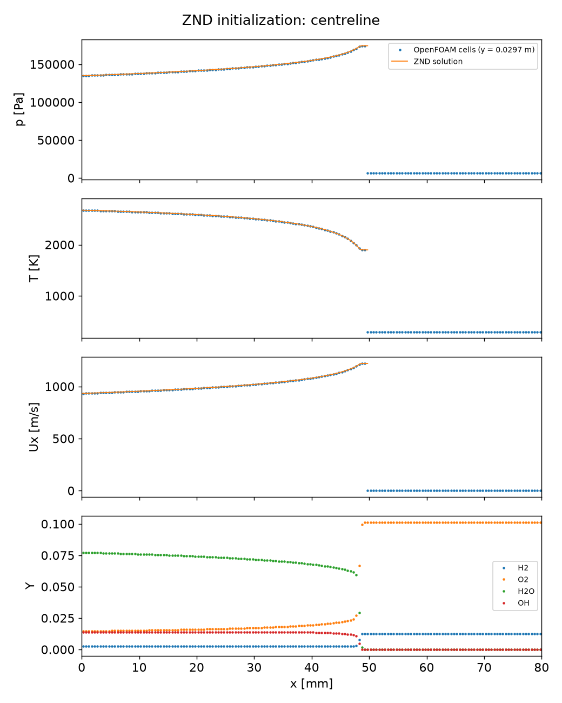
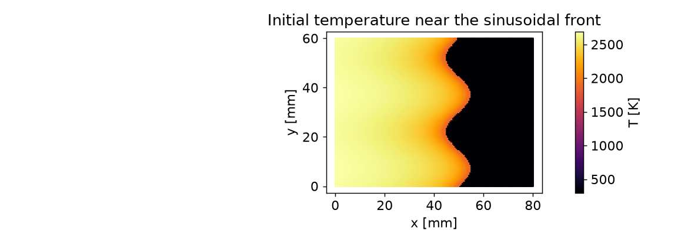

# Step 4 — Initializing the detonation from a ZND profile

This step creates the **starting state** of the 2D simulation: a detonation that is already
running, so the solver doesn't have to ignite one. It uses Dr. Ryan Johnson's scripts in
`stanford_collaboration/Wang/nn_chemistry/ZND_Init/` **unmodified**.

---------------------------------------------------------------------------------------------
## Part A — Background: what a detonation is and why we initialize from ZND

### A1. Detonation in one paragraph
A detonation is a **shock wave coupled to a reaction zone**. The leading shock compresses and
heats the fresh gas. After a short delay (the *induction zone*), the hot gas reacts. The heat
released expands the gas, and that expansion pushes the shock forward. In a steady state the
shock and the reaction zone move together at a fixed speed: the **Chapman–Jouguet (CJ) speed**
`D_CJ`.

### A2. The ZND model (Zel'dovich, von Neumann, Döring)
ZND is the simplest *structured* detonation model. It is **1D and steady in the shock frame**.
Moving along the profile from the shock into the burned gas:

| Location | Name | What happens |
|---|---|---|
| Just ahead of the shock | **Initial state** (state 1) | Our mixture: 2H₂ : O₂ : 7Ar (mole fractions 0.2/0.1/0.7), 6670 Pa, 298 K, at rest |
| Immediately behind the shock | **von Neumann (vN) spike** | Shock-compressed but **unreacted**. Pressure and density jump; T rises sharply; the composition is still the fresh mixture |
| Induction zone | — | Radicals (H, O, OH) build up slowly. T and p are nearly flat |
| Reaction / heat-release zone | — | Fast exothermic recombination (→ H₂O). T rises, p and ρ fall |
| End of the reaction zone | **CJ state** | Near-equilibrium products. In the shock frame the flow leaves at exactly the local sound speed |

The **induction length** (distance from the shock to the steepest temperature rise) is the
characteristic length scale. It sets how fine the mesh must be and how large the detonation
cells are.

### A3. Why start from a ZND profile?
You can start a detonation by putting a hot, high-pressure region in the domain (that's what
Stanford's `setFieldsDict` did: a 2500 K, 5.5 bar slab plus two hot cylinders). The gas then
has to go through **initiation**, a strongly overdriven transient that takes a long distance
to decay to the CJ state. Starting from the steady ZND profile instead puts a
*correctly structured* CJ detonation in the domain from step 1. That saves domain length and
compute time, and removes the initiation transient from the results.

### A4. Why the sinusoidal front?
A planar ZND front is an exact steady solution in 1D, but in 2D it would stay planar for a long
time (instabilities grow from round-off). Real H₂–O₂–Ar detonations are **cellular**: transverse
waves sweep along the front and leave a fish-scale pattern. Dr. Johnson's script bends the front
into a sinusoid,
```
x_front(y) = 0.05 + 0.005 * sin(4π y / 0.06)      [m]
```
(mean position 50 mm, amplitude 5 mm, **two wavelengths** across the 60 mm channel height).
This seeds transverse waves deterministically, so the cellular structure develops quickly and
reproducibly.

### A5. Shock frame vs. lab frame (the velocity)
SDToolbox solves ZND in the **shock frame**: the fresh gas flows into a stationary shock at
`U1 = D_CJ`, and `U(x)` is the gas speed relative to the shock. In the simulation (the **lab
frame**) the fresh gas is at rest and the shock moves in **+x**. So the lab-frame gas velocity
is
```
u_lab(x) = U1 − U(x)        (znd_solution_generator.py: vel_array = U1 - U)
```
Behind the shock this is **positive**: the burned gas follows the shock. Ahead of the shock
it is 0.

---------------------------------------------------------------------------------------------
## Part B — The workflow, step by step

All of it runs in one batch job, [`init.slurm`](init.slurm) (skx-dev, 1 core). It runs in the
case directory `$SCRATCH/ozone_detonation/init_case`, which is a copy of
`03_case/coarse_mesh_slip_of8`.

| # | Command | Input → Output | Notes |
|---|---|---|---|
| 1 | `blockMesh` | `system/blockMeshDict` → `constant/polyMesh` | 1000 × 120 cells, Δx = Δy = 0.5 mm |
| 2 | `postProcess -func writeCellCentres -time 0` | mesh → `0/Cx`, `0/Cy` (`0/C`, `0/Cz`) | Cell-centre coordinates, one value per cell, in OpenFOAM's cell order |
| 3 | `python znd_solution_generator.py` | `FFCM2_H2_Ar.yaml` → `ffcm2hydrogen_ZND_solution.csv` | SDToolbox: `CJspeed` → `PostShock_fr` (vN state) → `zndsolve` (integrate to 1 ms) |
| 4 | `python consolidate_from_OF.py` | `0/Cx`, `0/Cy` → `consolidated_with_xy_znd.csv` | Columns `Cx, Cy`, one row per cell |
| 5 | `python interpolate_znd_on_openfoam.py` | both CSVs → `initialization_for_openfoam.csv` | Per cell: if `Cx < x_front(Cy)`, cubic-spline the ZND profile at distance `x_front − Cx` behind the shock; otherwise use the fresh mixture |
| 6 | `python to_openfoam.py` | CSV → `0/T, 0/p, 0/H … 0/AR, 0/U` | Writes nonuniform fields. BCs: zeroGradient everywhere, U slip on top/bottom, frontAndBack empty |
| 7 | `verify_init.py` (ours, checks only) | `0/*` + ZND CSV → PASS/FAIL list, plots | See Part C |
| 8 | `detonationFoam_V2.0`, 2 steps on a throwaway copy | — | Confirms OpenFOAM reads the new fields |

### Details that matter (checked in the code)
- **Mixture.** `X = 'H2:0.2,O2:0.1,AR:0.7'` at `P = 6670 Pa`, `T = 298 K`. In mass fractions:
  H₂ 0.012772, O₂ 0.101362, Ar 0.885865. The same numbers are hard-coded for the unburned region
  in `interpolate_znd_on_openfoam.py`, and they match Stanford's `setFieldsDict`.
- **Mechanism.** Every step uses FFCM2: SDToolbox/Cantera read `FFCM2_H2_Ar.yaml`, and OpenFOAM
  reads `chemFFCM2`/`thermFFCM2`. The YAML in the case is byte-identical to
  `Wang/nn_chemistry/generated_src/FFCM2_H2_Ar.yaml`.
- **Species order** is the same everywhere: `H, H2, O, O2, OH, H2O, HO2, H2O2, AR` (YAML, chemFFCM2,
  ZND CSV columns, the column map in the interpolation script, the file list in `to_openfoam.py`).
- **ZND CSV format:** a space-separated header of quoted names
  (`"X" "Pressure" "Temperature" "Density" "Velocity" "H" … "AR"`), then one row per integration point.
  Units are SI: m, Pa, K, kg/m³, m/s; species are **mass fractions** (`znd_out['species']`).
- **Units written to OpenFOAM:** `p` [Pa] `[1 -1 -2 0 0 0 0]`, `T` [K], `U` [m/s] (x-component only),
  `Y` dimensionless. These are the units the solver expects.
- **Thermodynamic consistency.** OpenFOAM recomputes ρ and e from (p, T, Y) using its own JANAF
  polynomials (`thermFFCM2`), so the state is consistent with the solver's thermodynamics. Density
  from the ZND CSV is not written.
- **ZND tolerances** in `zndsolve`: BDF, `relTol=1e-20`, `absTol=1e-18`, `t_end=1e-3` s.

### Software environment (Step 4)
| Package | Version | Note |
|---|---|---|
| Python | 3.12.11 (`module load python/3.12.11`) | venv at `$WORK/venvs/znd` |
| Cantera | 3.1.0 (pip) | TACC's `cantera/3.1.0` module did not load into Python |
| SDToolbox | Caltech download (Python3 package), `$WORK/src/SDToolbox` | the same source as Stanford's `download_sdtoolbox.sh`; added to the venv with a `.pth` file |
| pandas | **2.2.3 (pinned)** | `interpolate_znd_on_openfoam.py` uses `read_csv(delim_whitespace=True)`, removed in pandas 3.0. Pinning lets the script run unmodified |
| numpy / scipy / matplotlib | latest pip | |

Setup commands (login node, done once):
```bash
module load python/3.12.11
python3 -m venv $WORK/venvs/znd && source $WORK/venvs/znd/bin/activate
pip install cantera==3.1.0 numpy scipy "pandas==2.2.3" matplotlib
mkdir -p $WORK/src/SDToolbox && cd $WORK/src/SDToolbox
curl -o SDToolbox.zip https://shepherd.caltech.edu/EDL/PublicResources/sdt/SDToolbox.zip && unzip SDToolbox.zip && rm SDToolbox.zip
echo $WORK/src/SDToolbox/SDToolbox/Python3 > $(python -c "import site;print(site.getsitepackages()[0])")/sdtoolbox.pth
```
Run:
```bash
cd ~/ozone_detonation/04_znd_init && sbatch init.slurm
```

---------------------------------------------------------------------------------------------
## Part C — Results and verification (job 3727629, 6.4 min, about 0.1 SU)

### C1. The ZND solution (FFCM2, 2H₂:O₂:7Ar, 6670 Pa, 298 K)
| Quantity | Value | Where it comes from |
|---|---|---|
| CJ detonation speed `D_CJ` | **1615.9 m/s** | `CJspeed` (recomputed in `verify_init.py`) |
| von Neumann spike | **174.5 kPa, 1900 K**, ρ = 0.349 kg/m³, u_lab = 1222 m/s | first row of the ZND CSV |
| Induction length (shock → max dT/dx) | **1.56 mm** | ZND CSV |
| End of the ZND integration (x = 0.139 m, t = 1 ms) | 121.5 kPa, 2786 K, u_lab = 836 m/s | last row (close to the CJ state) |
| ZND points | 7602 | |

`znd_solution_generator.py` took 6 s. It prints one harmless SciPy warning: the requested
`relTol=1e-20` is below double precision, so SciPy raises it to 2.2e-14.

### C2. Resolution of the induction zone (why mesh resolution matters)
| Mesh level | Cell size | Cells per induction length (1.56 mm) |
|---|---|---|
| base mesh | 0.5 mm | ~3 |
| **AMR level 2 (current setting, `maxRefinement 2`)** | **0.125 mm** | **~12** |
| AMR level 3 (Stanford's setting) | 0.0625 mm | ~25 |

Roughly 10–20+ cells per induction length is typically considered the minimum to capture
cellular structure qualitatively. The base mesh alone (~3 cells) is far too coarse. This is
why AMR matters: it refines where `|∇ρ|` is large, which is around the shock and the reaction zone.

### C3. What the initialized field looks like
- **12000 cells** (10%) lie behind the sinusoidal front and carry the ZND profile, at up to
  54.7 mm behind the shock. The ZND solution reaches 139 mm, so the spline only interpolates
  and never extrapolates. The other 108000 cells hold fresh mixture at rest.
- On the centreline the OpenFOAM cells lie on the ZND curves:
  
- The front is a clean two-wavelength sinusoid:
  

### C4. Verification: `verify_init.py`, 15/15 checks passed
```
[PASS] Cx, Cy = exact uniform-grid cell centres in OpenFOAM cell order  -- max deviation 5.6e-17 m
[PASS] Mechanism species order = FFCM2 order used by the scripts
[PASS] ZND CSV species order = FFCM2 order
[PASS] All fields have one value per cell  -- 120000 cells
[PASS] No NaN/Inf
[PASS] Mass fractions >= 0
[PASS] Sum of 9 mass fractions = 1  -- max |sumY-1| = 8.34e-08
[PASS] p > 0 and T > 0  -- p 6670..1.745e+05 Pa, T 298..2691 K
[PASS] U is purely x-directed
[PASS] Ahead of front: 6670 Pa, 298 K, H2/O2/AR = 2/1/7 by mole, at rest
[PASS] ZND profile extends past the deepest burned cell
[PASS] Behind front: gas moves +x  -- Ux 924..1222 m/s
[PASS] Peak p in field <= ZND von Neumann pressure
[PASS] Field boundary names match mesh patches
[PASS] U: slip on top/bottom; zeroGradient inlet/outlet
```
Full output: [`results/verify_summary.json`](results/verify_summary.json). (The first run flagged
the boundary-name check because of a parsing bug in `verify_init.py` itself. After the fix
it was re-run on the same fields.)

**OpenFOAM accepts the fields:** 2 serial Euler steps on a copy:
```
StandardChemistryModel: Number of species = 9 and reactions = 27
solverType = Euler
Time = 1e-09  min/max(p) = 6670, 174485.2   min/max(T) = 298, 2690.97
Time = 2e-09  min/max(p) = 6670, 174485.0   min/max(T) = 298, 2690.97
End
```

### C5. Where the outputs are
- Initialized case, ready to decompose: `$SCRATCH/ozone_detonation/init_case` (purged after 10 days)
- Persistent copy: `$WORK/ozone_detonation/znd_init_3727629/` (`0/`, ZND CSV, plots, logs)

---------------------------------------------------------------------------------------------
## Part D — Problems met and how they were solved
| Problem | Cause | Solution |
|---|---|---|
| `postProcess -func writeCellCentres` crashes: `error in IOstream "OSHA1stream.sinkFile_"` | **TACC's OpenFOAM 8 build fails on every function object** (also `writeCellVolumes`, and functions in `controlDict`) | Write the cell centres with **TACC's OpenFOAM 12** (`foamPostProcess -func writeCellCentres`) on the same mesh, in an isolated subshell, then copy `Ccx`/`Ccy` to `0/Cx`/`0/Cy`. Checked against the exact grid (max deviation 5.6e-17 m). ⚠️ This also means **no function objects (probes, fieldMinMax, …) in our OpenFOAM 8 runs.** |
| pandas 3 removed `delim_whitespace` | `interpolate_znd_on_openfoam.py` uses it | pin `pandas==2.2.3` (the script runs unmodified, with only a FutureWarning) |
| `module load X \| tail` "did nothing" | a pipe runs `module load` in a subshell | never pipe `module load` |

## Part E — Physics notes for discussion
- **Left boundary.** The `inlet` (x = 0) is `zeroGradient`. Burned gas there moves at about +930 m/s, so the
  boundary keeps feeding gas into the domain, much like a piston following the detonation, rather than letting
  a Taylor expansion develop behind it as it would behind a closed end. This is Stanford's setup and was kept
  on purpose (user decision 2026-11-16).
- **Not a true CJ state at x = 0.** The domain only holds 50 mm of the profile behind the shock, and the reaction
  zone tail extends further (about 139 mm to near-equilibrium). This is normal for this approach. The front relaxes
  to its own propagating structure over the first few centimetres of travel.
